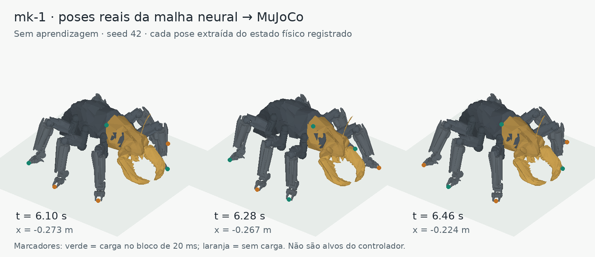

# Veguinha mini

Hexápode experimental com circuitos de neurônios pulsados em Brian2 e corpo articulado em MuJoCo. Desenvolvido e executado em Python no Android/Termux, com interface local no navegador.

O objetivo é estudar como movimento, percepção e aprendizagem podem surgir da interação entre circuitos neurais, corpo e ambiente. O torque vem da atividade dos pools motores; o navegador modifica o mundo e os parâmetros da experiência.



## Estado atual

- Corpo mk-1 com 18 juntas ativas, três por perna, massa total de 0,316 kg e contatos físicos com gravidade. O corpo anterior, de duas juntas por perna, permanece como controle.
- App completo configurado com 6.660 neurônios e 367.360 sinapses, incluindo circuitos visuais e duas presas experimentais. O tamanho depende da configuração.
- Neurônios Izhikevich, conectividade regional, circuitos motores locais, decodificação flexor menos extensor e feedback proprioceptivo/de carga.
- Plasticidade motora local com elegibilidade e modulação por disparos dopaminérgicos; homeostase e poda experimental.
- Olfato bilateral, visão binocular, disparidade, fluxo óptico, tato, nocicepção, paladar, energia e ingestão por contato oral.
- Imagens de 320×180 por olho: centro nativo, anel intermediário amostrado a cada 2 pixels e bordas a cada 4 pixels, com transição suave. O estéreo usa somente os pixels centrais nativos.
- Viewer web, raster, taxas regionais, pesos médios, ablações, parâmetros, métricas e checkpoints locais.

**O Veguinha já anda nas simulações.** Ainda falta demonstrar, contra os controles, quanto a plasticidade melhora essa marcha. Os circuitos inatos também produzem oscilação e deslocamento, portanto andar por si só não prova aprendizagem. Navegação, caça e manutenção corporal eficientes também continuam em investigação. Os mecanismos experimentais implementados não devem ser confundidos com capacidades já validadas.

## Instalação

```sh
git clone https://github.com/jotaro41day/veguinha-mini.git
cd veguinha-mini
python -m pip install -r requirements.txt
```

No Termux, instale antes Python e as ferramentas de compilação:

```sh
pkg update
pkg install python clang make pkg-config
```

As versões do ambiente de referência estão fixadas em `requirements.txt`. MuJoCo e a compilação de algumas dependências no Android podem exigir builds específicos do Termux; a disponibilidade de wheels varia. A primeira inicialização pode compilar Cython e ser mais lenta. O repositório não inclui os pacotes binários instalados no celular original nem garante instalação por um único comando em qualquer aparelho.

## Abrir o laboratório

```sh
./scripts/run.sh
```

Abra **http://127.0.0.1:8000/** no navegador do mesmo aparelho e toque **Continuar**. O viewer 3D usa a porta **8002**; o WebSocket do painel usa **8001**, com fallback SSE/POST. A simulação começa pausada. Renderização e passo da simulação são separados.

```sh
# Backend NumPy para diagnóstico, sem compilação Cython
./scripts/run.sh --backend numpy

# Controle com plasticidade motora desligada
./scripts/run.sh --phase4

# Laboratório sem viewer 3D
./scripts/run.sh --no-viewer
```

Checkpoints são arquivos locais confiáveis de pesos e estado; não estão publicados. Não carregue arquivos pickle de origem desconhecida. O estado vivo do aparelho original não é necessário para iniciar uma nova experiência.

## Regulação fisiológica e adaptação sensorial

A execução normal do mk-1 usa uma curva contínua de necessidade energética, sem perder toda a sensibilidade após os primeiros 5% de consumo. Déficit de reserva, fadiga e familiaridade olfatória têm entradas separadas: a fadiga aumenta a pressão neural de repouso, a necessidade reforça a saliência olfatória, e receptores habituam a odores persistentes e recuperam a sensibilidade após sua ausência.

A habituação é uma memória da transdução sensorial, não prova de associação aprendida. A novidade olfatória excita os neurônios de octopamina; dor e contato não são atenuados por esse filtro. Os torques continuam saindo dos pools motores. Nenhuma ação é selecionada por um temporizador ou uma máquina de estados.

Para reproduzir os ganhos anteriores em um controle pareado, use `./scripts/run.sh --legacy-homeostasis`. Ao comparar aprendizagem, mantenha a homeostase igual nos grupos e altere apenas a plasticidade. Os estados dos receptores são preservados nos checkpoints. O painel recebe também o campo `homeostasis` nos snapshots, com déficit de reserva, pressão de fadiga e familiaridade por canal.

## Testes e resultados

Um lote curto para conferir visão e integração da entrada do app:

```sh
python -m unittest veguinha_mini.tests.test_foveated veguinha_mini.tests.test_gait_entrypoint
```

A bateria completa contém ensaios que compilam código e simulam circuitos; pode levar bastante tempo no celular:

```sh
python -m unittest discover -s veguinha_mini/tests
```

A velocidade frontal assinada no referencial do corpo é a medida principal de locomoção. Compare condições com seeds pareadas, mesma física e mesma janela. Registre quedas, apoio, alternância, energia e atividade neural separadamente. Um corpo que oscila ou desliza não demonstra automaticamente uma marcha funcional.

Veja [arquitetura](docs/architecture.md), [resultados e limitações](docs/results.md) e [notas de desenvolvimento](NOTES.md). Um conjunto pequeno de medições e dados geométricos foi incluído; os logs, checkpoints e arquivos de treinamento completos ficaram fora do repositório.

## Contribuições

Contribuições de diagnóstico, reprodução e correções são bem-vindas. Consulte [CONTRIBUTING.md](CONTRIBUTING.md). O código usa [licença MIT](LICENSE). O corpo mk-1 foi modelado pelo próprio autor do projeto, [jotaro41day](https://github.com/jotaro41day), e disponibilizado sob CC0.
