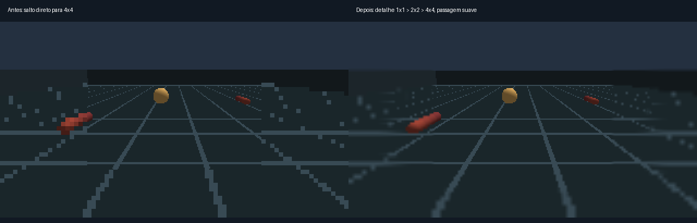

# Resultados e limites de interpretação

## Locomoção

Os arquivos `veguinha_mini/results/gait_loop_v1/report.json` e `trials.csv` preservam um ensaio curto, sem plasticidade, em três seeds (42, 43, 44), com 12 s simulados e janela final de 6–12 s. Esses dados pertencem à configuração da época; não são uma validação de todos os sensores e parâmetros acrescentados depois.

A configuração modular apresentou deslocamento e alternância de apoio. A diferença de velocidade contra motores embaralhados não foi conclusiva. Não há aqui evidência suficiente de marcha aprendida, resistência por longos períodos, navegação robusta ou generalização para seeds novas.

## Estéreo

Dados em `veguinha_mini/results/binocular_v1/`. No ensaio com planos texturizados a 0,6 m, 1,0 m e 1,8 m, as profundidades frontais medianas foram aproximadamente 0,600 m, 0,993 m e 1,800 m. As estimativas dependem de textura, geometria e correspondências válidas; a grade repetida do chão produz ambiguidades. Profundidade frontal e distância ao ponto não são a mesma grandeza.

## Transição da visão periférica

O benchmark em `veguinha_mini/results/foveated_gradient_v1/benchmark.json` compara a amostragem antiga com a nova em uma cena imóvel e com 12 capturas alternadas por condição no aparelho 25078PC3EG. O centro e o fluxo óptico foram preservados no teste; a faixa intermediária aumenta o custo da câmera. Esse tempo não é o custo total de rede e corpo e não é um teste de aquecimento prolongado.

## Como continuar

Prioridades: demonstrar benefício da plasticidade contra o mesmo recém-nascido, DAN embaralhado e sinal desacoplado; usar seeds novas para confirmação; distinguir problemas motores, sensoriais e físicos por ablação. Não confundir capacidade implementada, oscilação neural, movimento de uma junta e caminhada funcional.

## Regulação fisiológica e habituação

Em três seeds do circuito descendente reduzido, fadiga alta suprimiu a saída motora e a recuperação reabriu a permissão. Em uma cópia pareada da rede completa e do corpo, saída motora média na janela cansada: 4,149 Hz com a regulação antiga e 0,139 Hz com a nova; após recuperação: 4,661 Hz na versão nova. O corpo permaneceu estável nas janelas curtas. As intervenções de energia/fadiga ocorreram somente nas cópias de ensaio, sem alterar a sessão viva.

O ganho do receptor para um odor persistente caiu de 0,997 para 0,489 e voltou a 0,990 após ausência. Essa habituação sensorial não é aprendizado associativo nem demonstra adaptação motora geral. O protocolo completo, dados individuais e limites estão em [homeostasis_v2/REPORT.md](../veguinha_mini/results/homeostasis_v2/REPORT.md).
